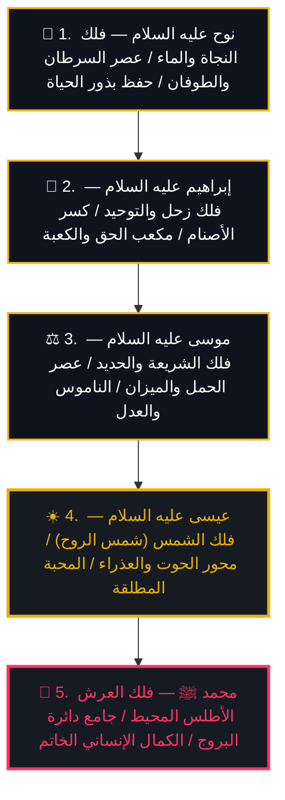

# الهيكل الكوني لأولي العزم من الرسل: الأعمدة الخمسة للتاريخ والوعي الإنساني

> **"فَاصْبِرْ كَمَا صَبَرَ أُولُو الْعَزْمِ مِنَ الرُّسُلِ"**
> يمثل أولو العزم الخمسة (نوح، إبراهيم، موسى، عيسى، محمد عليهم صلوات الله وسلامه) **الأعمدة التأسيسية الخمسة للوعي البشري**، وتتنزل رسالاتهم بالتطابق الدقيق مع مفاصل الدورات الفلكية الكبرى، وترنح المحور، والأفلاك السماوية.

---

## 🏛️ مصفوفة أولي العزم الخمسة في الكوزمولوجيا الكبرى

| النبي من أولي العزم | المَفصِل الفلكي والبرجي الحاكم | الفلك والمقام السماوي | الرمز الأركيولوجي والتاريخي | النقلة الروحية في الوعي البشري | الشاهد من التراث والمخطوطات |
|---|---|---|---|---|---|
| **1. النبي نوح عليه السلام** (الأب الثاني للبشرية) | **عصر السرطان (Cancer)** (8000 – 6000 ق.م) طوفان ذوبان الجليد المائي | **فلك الماء الكوني والرحم** (السفينة / الفلك المشحون) | **الفلك (السفينة)** أولى القرى المائية (أريحا وتشاتال هويوك) | **وعي النجاة وإعادة البعث:** تطهير الأرض بالماء من الفساد، وحفظ بذور الحياة في رحم السفينة وتأسيس العهد الإنساني الجديد. | *«فص حكمة سبوحية في كلمة نوحية»* — ابن عربي في الفصوص: دعوة نوح جمعت بين التنزيه والتشبيه في بحر الوجود، وفُلكه هو سر النجاة في طوفان الكثرة. |
| **2. النبي إبراهيم الخليل عليه السلام** (إمام الحنفاء وشيخ الأنبياء) | **عصر الثور $\rightarrow$ الحمل** (مطلع الألفية الثانية ق.م) الفداء بالكبش وتدشين الحنيفية | **فلك زحل (السماء السابعة)** (فلك التوحيد والعهد الأبدي) | **الكعبة المشرفة (مكعب الحق)** مقام التوحيد المجرد من الأصنام | **وعي التوحيد المفارق:** كسر أصنام النجوم والكواكب (الشمس والقمر والزهرة: *«لا أحب الآفلين»*)، والوصول إلى خالق الأفلاك والمكعب الحق. | *«فص حكمة مهيمية في كلمة إبراهيمية»* — ابن عربي: إبراهيم هو الخليل الذي تخللت محبته كل ذرات الوجود، مقامه زحل (التجرد والصمت وبناء بيت الله). |
| **3. النبي موسى الكليم عليه السلام** (صاحب التوراة والشريعة) | **عصر الحمل (Aries)** (2000 ق.م – مطلع الميلاد) المقابل لميزان العدل (Libra) | **فلك المشتري والمريخ** (السماء 5 و6: البأس والشريعة) | **ألواح الوصايا العشر** الكبش المقدس، الشوفار، وصهر الحديد | **وعي الناموس والشريعة الصارمة:** كسر عبادة العجل (بقايا طاقة عصر الثور)، إحلال رمزية الكبش والشوفار، وتنزيل الوصايا العشر لإقامة الميزان. | *«فص حكمة علوية في كلمة هارونية وموسوية»* — ابن عربي: موسى جمع بين الشدة المريخية الإلهية (صهر العجل) والحكمة المشترية التشريعية. |
| **4. السيد المسيح عيسى عليه السلام** (روح الله وكلمته) | **عصر الحوت $\leftrightarrow$ العذراء** (الميلاد – ~2000 م) محور السمكة والولادة البتولية | **فلك الشمس (السماء الرابعة)** (شمس الروح والنور والمحبة) | **رمز السمكة (Ichthys)** سنبلة القمح في بيت لحم (بيت الخبز) | **وعي شمس الروح والمحبة المطلقة:** كسر حرفية الناموس لصالح جوهر الروح، إحياء الموتى، معجزة تكثير السمك والخبز، والولادة العذرية من مريم البتول. | *«فص حكمة روحية في كلمة عيسوية»* — ابن عربي: عيسى هو النفس الإلهي النازل بالروح، مقامه فلك الشمس الذي يفيض الحياة على العالم. |
| **5. النبي الخاتم محمد ﷺ** (خاتم النبيين ورحمة للعالمين) | **جامع دائرة البروج الاثني عشر** (العصر الخاتم الممتد لقيام الساعة) | **فلك العرش الأطلس المحيط** (ما وراء سدرة المنتهى والسماوات السبع) | **القرآن الكريم الخالد** والحرم المكي والنبوي الشريف | **وعي الكمال الإنساني الجامع:** معراج الروح فوق السماوات السبع إلى مقام «قاب قوسين أو أدنى»، ختام النبوات، والرسالة الشاملة التي وحدت كل الشرائع. | *«فص حكمة فردية في كلمة محمدية»* — ابن عربي: الحقيقة المحمدية هي الفلك المحيط الأعظم بالوجود، وأول التعينات النورانية، وخاتم الرسالات. |

---

## 🧭 التدرج الصعودي للوعي عبر أولي العزم الخمسة:

---

## ⚡ الروابط المتصلة:
- [[Universal_Esoteric_Map_of_Consciousness]]
- [[Prophetic_Spheres_Comparative_Master_Matrix]]
- [[Age_of_Cancer_Deluge]]
- [[Age_of_Aries_Libra_Polarity]]
- [[Age_of_Pisces_Virgo_Polarity]]
- [[Universal_Throne_Sphere_Muhammad]]
- [[MOC_Grand_Knowledge_Synthesis]]
