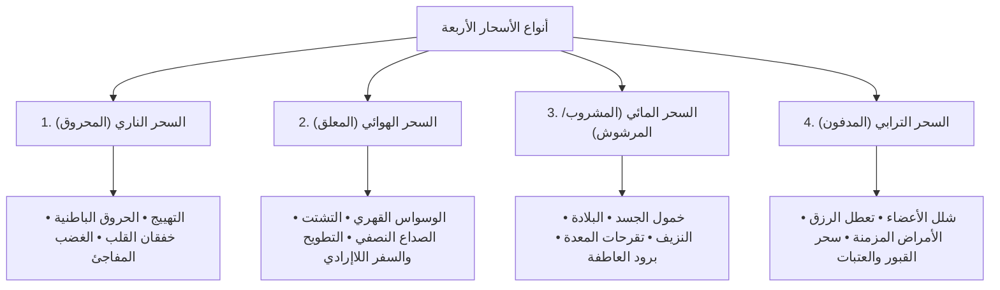

# المخطوطة الروحية الجامعة: كوزمولوجيا الأفلاك، ساعات الأيام، المنازل القمرية، والأجساد السبعة
## سفر النواميس الكبرى: تشريح علم الحرف، الساعات الفلكية، ربط الطبائع الأربع بالأسحار، ومسارات الاختراق في الأجساد النورانية

---

## ديباجة السفر ومنهج التأسيس من الصفر

بسم الله الرحمن الرحيم، والصلاة والسلام على رسول الله الصادق الأمين.

هذه المخطوطة ليست مجرد سرد نظري، بل هي **تفكيك كوزمولوجي وباطني شامل يبدأ من نقطة الصفر (Ab Initio)**؛ تجمع بين:
1. الفلك الحسابي الرصدي البابلي والهرمسي.
2. علم الحرف والأوفاق والمنازل القمرية الـ 28 كما دونها أئمة الصنعة (البوني في *شمس المعارف* و*شمس الآفاق*، المجريطي في *غاية الحكيم*، وابن عربي في *الفتوحات المكية*).
3. التشريح الطاقي للأجساد الإنسانية السبعة (The 7 Subtle Bodies).
4. الميزان التوحيدي القرآني الصارم الذي يرد كل أثر إلى مشيئة الله المطلقة ويفكك حبال الوهم والشرك.

---

## الباب الأول: نظام ساعات الأيام الفلكية الـ 24 والترتيب الكلداني

في علوم الفلك القديمة، لا تتطابق "الساعة الفلكية" مع الساعة الميكانيكية ذات الـ 60 دقيقة؛ بل تُحسب كالتالي:
* **الساعة الفلكية النهارية**: $\frac{\text{الزمن من شروق الشمس إلى غروبها}}{12}$.
* **الساعة الفلكية الليلية**: $\frac{\text{الزمن من غروب الشمس إلى شروقها}}{12}$.

### 1.1 الترتيب الكلداني لمدارات الكواكب (Chaldean Order)
تنحدر طاقات الكواكب وفق بعدها التنازلي عن الأرض:
$$\text{زحل ♄} \longrightarrow \text{المشتري ♃} \longrightarrow \text{المريخ ♂} \longrightarrow \text{الشمس ☉} \longrightarrow \text{الزهرة ♀} \longrightarrow \text{عطارد ☿} \longrightarrow \text{القمر ☽}$$

القاعدة الكونية: **الساعة الأولى من نهار كل يوم يحكمها كوكب ذلك اليوم**، ثم تتوالى الساعات تباعاً بالترتيب الكلداني، فإذا انتهت ساعات النهار الاثنتا عشرة، دخلت ساعات الليل بالترتيب المتصل نفسه، وتأتي الساعة الأولى من نهار اليوم التالي مطابقة لكوكبه حتماً!

### 1.2 الجدول الكوني الكامل لساعات نهار الأيام السبعة:

| الساعة | الأحد (الشمس) | الإثنين (القمر) | الثلاثاء (المريخ) | الأربعاء (عطارد) | الخميس (المشتري) | الجمعة (الزهرة) | السبت (زحل) | طبيعة الساعة الطاقية |
| :---: | :---: | :---: | :---: | :---: | :---: | :---: | :---: | :---: |
| **1 (الشروق)** | **الشمس** | **القمر** | **المريخ** | **عطارد** | **المشتري** | **الزهرة** | **زحل** | ساعة حكم اليوم الرئيسي |
| **2** | الزهرة | زحل | الشمس | القمر | المريخ | عطارد | المشتري | سعد / نحس حسب الكوكب |
| **3** | عطارد | المشتري | الزهرة | زحل | الشمس | القمر | المريخ | ممتزجة / متقلبة |
| **4** | القمر | المريخ | عطارد | المشتري | الزهرة | زحل | الشمس | سريعة التحول والفيض |
| **5** | زحل | الشمس | القمر | المريخ | عطارد | المشتري | الزهرة | ثقيلة، قابضة، نحسة |
| **6 (الزوال)** | المشتري | الزهرة | زحل | الشمس | القمر | المريخ | عطارد | سعد أكبر، قمة الاتساع |
| **7** | المريخ | عطارد | المشتري | الزهرة | زحل | الشمس | القمر | حارقة، قاطعة، غضبية |
| **8** | الشمس | القمر | المريخ | عطارد | المشتري | الزهرة | زحل | سيادية، شرف، رفعة |
| **9** | الزهرة | زحل | الشمس | القمر | المريخ | عطارد | المشتري | سعد أصغر، جلب، ألفة |
| **10** | عطارد | المشتري | الزهرة | زحل | الشمس | القمر | المريخ | فكرية، عقد العقود |
| **11** | القمر | المريخ | عطارد | المشتري | الزهرة | زحل | الشمس | مائية، اضطراب المشاعر |
| **12 (الغروب)** | زحل | الشمس | القمر | المريخ | عطارد | المشتري | الزهرة | إغلاق البوابات النهارية |

### 1.3 جدول ساعات ليل الأيام السبعة (تكملة الدورة الكلدانية):

| الساعة | ليلة الأحد | ليلة الإثنين | ليلة الثلاثاء | ليلة الأربعاء | ليلة الخميس | ليلة الجمعة | ليلة السبت | طبيعة الطاقة الليلية |
| :---: | :---: | :---: | :---: | :---: | :---: | :---: | :---: | :---: |
| **1 (الغروب)** | المشتري | الزهرة | زحل | الشمس | القمر | المريخ | عطارد | بدء سكون الأثير |
| **2** | المريخ | عطارد | المشتري | الزهرة | زحل | الشمس | القمر | اشتعال الطاقات السفلية |
| **3** | الشمس | القمر | المريخ | عطارد | المشتري | الزهرة | زحل | إشعاع باطني |
| **4** | الزهرة | زحل | الشمس | القمر | المريخ | عطارد | المشتري | هدأة المشاعر والأحلام |
| **5** | عطارد | المشتري | الزهرة | زحل | الشمس | القمر | المريخ | نشاط القرناء والوساوس |
| **6 (منتصف الليل)** | القمر | المريخ | عطارد | المشتري | الزهرة | زحل | الشمس | ذروة البوابات الأثيرية |
| **7** | زحل | الشمس | القمر | المريخ | عطارد | المشتري | الزهرة | أثقل ساعات الليل (نحس) |
| **8** | المشتري | الزهرة | زحل | الشمس | القمر | المريخ | عطارد | تدفق السكينة والرحمة |
| **9** | المريخ | عطارد | المشتري | الزهرة | زحل | الشمس | القمر | حركة العوارض النارية |
| **10** | الشمس | القمر | المريخ | عطارد | المشتري | الزهرة | زحل | تباشير النور الأول |
| **11** | الزهرة | زحل | الشمس | القمر | المريخ | عطارد | المشتري | وقت السحر والاستغفار |
| **12 (قبل الفجر)** | عطارد | المشتري | الزهرة | زحل | الشمس | القمر | المريخ | انقشاع ظلمة الليل |

---

## الباب الثاني: منازل القمر الـ 28 والتشريح الحرفي والطبائعي

يقسم الفلكيون مسار القمر الشهري إلى **28 منزلة فلكية**، تمكث الشمس في كل منزلة نحو 13 يوماً، ويمكث القمر في كل منها يوماً واحداً وبضع ساعات:
$$\text{مقدار المنزلة الواحدة} = \frac{360^\circ}{28} = 12^\circ \text{ و } 51' \text{ و } 25''$$

### 2.1 المصفوفة الكبرى للمنازل القمرية الـ 28:

| # | اسم المنزلة | البرج الحاوي | الحرف الأبجدي | طبيعة المنزلة | الكوكب الحاكم | البخور المطابق | الخاصية والعمل في المخطوطات |
| :---: | :---: | :---: | :---: | :---: | :---: | :---: | :---: |
| **1** | **الشَّرَطَان** | الحمل ($0^\circ - 12^\circ 51'$) | **أ** | نارية يابسة | المريخ | القسط والكندر | للمحبة وإثارة الحروب والسفر |
| **2** | **البُطَيْن** | الحمل ($12^\circ 51' - 25^\circ 42'$) | **ب** | ترابية باردة | الزهرة | اللبان الأبيض | لطلب الدفائن واستخراج الكنوز والزرع |
| **3** | **الثُّرَيَّا** | الحمل/الثور | **ج** | هوائية حارة | عطارد | الصندل الأحمر | للوفاق والألفة والأرزاق والصيد |
| **4** | **الدَّبَرَان** | الثور ($8^\circ 34' - 21^\circ 25'$) | **د** | مائية باردة | القمر | الميعة السائلة | سحر البغضاء، التفرقة، وهدم الأبنية |
| **5** | **الهَقْعَة** | الثور/الجوزاء | **هـ** | نارية حارة | الشمس | المسك والكافور | لإصلاح الفاسد، الشفاء، والمصالحات |
| **6** | **الهَنْعَة** | الجوزاء ($4^\circ 17' - 17^\circ 08'$) | **و** | ترابية يابسة | الزهرة | اللبان والجاوي | سحر التهييج والمحبة وقضاء الحاجات |
| **7** | **الذِّرَاع** | الجوزاء/السرطان | **ز** | هوائية رطبة | عطارد | السندروس | للمودة، دخول الحكام، وربط اللسان |
| **8** | **النَّثْرَة** | السرطان ($0^\circ - 12^\circ 51'$) | **ح** | مائية باردة | القمر | الكافور والعود | لرد المسافرين وعقد الخصوم |
| **9** | **الطَّرْف** | السرطان/الأسد | **ط** | نارية يابسة | الشمس | الكبريت واللبان | لعقد الألسن، النحس، وسقم الأبدان |
| **10** | **الجَبْهَة** | الأسد ($8^\circ 34' - 21^\circ 25'$) | **ي** | ترابية باردة | المريخ | الصندل الأصفر | للإصلاح ونصرة المظلوم والمحبة |
| **11** | **الزُّبْرَة** | الأسد/العذراء | **ك** | هوائية حارة | المشتري | عود القماري | فك الأسحار وخلاص المسجونين |
| **12** | **الصَّرْفَة** | العذراء ($4^\circ 17' - 17^\circ 08'$) | **ل** | مائية باردة | عطارد | اللبان والمستكة | تفرقة الأشرار وتشتيت الشركاء |
| **13** | **العَوَّاء** | العذراء/الميزان | **م** | نارية حارة | الزهرة | دهن الورد | الجلب، التجارة، وعقد المحبة الشديدة |
| **14** | **السِّمَاك** | الميزان ($0^\circ - 12^\circ 51'$) | **ن** | ترابية يابسة | المريخ | القسط والميعة | للشفاء وعلاج المريض وعقد الأعداء |
| **15** | **الغَفْر** | الميزان/العقرب | **س** | هوائية رطبة | المشتري | الصندل الأبيض | استخراج الأسرار، الألفة، ودفع العدو |
| **16** | **الزُّبَانَى** | العقرب ($8^\circ 34' - 21^\circ 25'$) | **ع** | مائية باردة | زحل | الحلتيت والمقل | سحر العداوة والتفرقة وكساد التجارة |
| **17** | **الإِكْلِيل** | العقرب/القوس | **ف** | نارية يابسة | المريخ | الجاوي الأحمر | تثبيت الزرع وربط السارق ورد الكيد |
| **18** | **القَلْب** | القوس ($4^\circ 17' - 17^\circ 08'$) | **ص** | ترابية باردة | المشتري | المسك الأبيض | إشعال الفتن والنحس وإضعاف العدو |
| **19** | **الشَّوْلَة** | القوس/الجدي | **ق** | هوائية حارة | زحل | الكبريت الأسود | سحر الخراب والنزيف وتطويح العقل |
| **20** | **النَّعَائِم** | الجدي ($0^\circ - 12^\circ 51'$) | **ر** | مائية باردة | الزهرة | اللبان الذكر | للمحبة والقبول واستجلاب القلوب |
| **21** | **البَلْدَة** | الجدي/الدلو | **ش** | نارية حارة | زحل | الحلتيت والصبر | لتقييد الخصوم والخراب وعقد السفر |
| **22** | **سَعْدُ الذَّابِح** | الدلو ($8^\circ 34' - 21^\circ 25'$) | **ت** | ترابية يابسة | المريخ | المقل الأزرق | سحر النزاع والفرقة والهرب |
| **23** | **سَعْدُ بُلَع** | الدلو/الحوت | **ث** | هوائية رطبة | المشتري | الصندل والعود | خلاص الأسير وعلاج المرض وإبرام العقود |
| **24** | **سَعْدُ السُّعُود** | الحوت ($4^\circ 17' - 17^\circ 08'$) | **خ** | مائية رطبة | الزهرة | المسك والجاوي | أعظم منازل السعد للزواج والتجارة |
| **25** | **سَعْدُ الأَخْبِيَة** | الحوت/الحمل | **ذ** | نارية يابسة | زحل | لبان الذكر | كشف المخبأ وفتح الكنوز والأسرار |
| **26** | **الفَرْغُ المُقَدَّم** | الحمل ($17^\circ 08' - 0^\circ$) | **ض** | ترابية باردة | المشتري | الكافور الأبيض | للمحبة والألفة وتوطيد الصداقات |
| **27** | **الفَرْغُ المُؤَخَّر** | الثور ($0^\circ - 12^\circ 51'$) | **ظ** | هوائية حارة | المريخ | القسط والميعة | التفرقة وإتلاف الزرع والنحس |
| **28** | **الرَّشَاء (بطن الحوت)** | الثور ($12^\circ 51' - 25^\circ 42'$) | **غ** | مائية باردة | الزهرة | الصندل الأبيض | لحفظ الأموال والسلامة في البحر والبر |

---

## الباب الثالث: ميزان طبائع الحروف الـ 28 والتركيب السميائي

قسّم علماء الحروف والسمياء الأبجدية العربية الـ 28 حرفاً بالتساوي التام على **الطبائع الأربع** (7 أحرف لكل عنصر):

### 3.1 جداول العناصر الحرفية الأربعة:
1. **الحروف النارية (أَهْطَمْفَشَذْ)**:
   * **الأحرف**: (أ - هـ - ط - م - ف - ش - ذ).
   * **الطبيعة**: حارة يابسة.
   * **الخصائص الطاقية**: التهييج، الحرق، الحركة السريعة، إشعال الشهوة، الحميات الجسدية، وسحر القلوب.
2. **الحروف الترابية (بَوْيَنَصْتَضْ)**:
   * **الأحرف**: (ب - و - ي - ن - ص - ت - ض).
   * **الطبيعة**: باردة يابسة.
   * **الخصائص الطاقية**: التثبيت، الربط، الثقل، الدفن، إطالة المرض، التعطيل، وتثبيت النوايا.
3. **الحروف الهوائية (جَزْكَسَقَثَظْ)**:
   * **الأحرف**: (ج - ز - ك - س - ق - ث - ظ).
   * **الطبيعة**: حارة رطبة.
   * **الخصائص الطاقية**: الوسوسة، التشتت، التخاطر، الطيران، التطويح الذهني، والريح الموجهة.
4. **الحروف المائية (دَحْلَعَرَخَغْ)**:
   * **الأحرف**: (د - ح - ل - ع - ر - خ - غ).
   * **الطبيعة**: باردة رطبة.
   * **الخصائص الطاقية**: البرودة، التبريد، السكون، النزيف، طمس المشاعر، والكساد والركود.

---

## الباب الرابع: ربط الطبائع الأربع بأنواع الأسحار وتأثيراتها الفيزيائية

الساحر القديم لم يكن يصنع سحراً عشوائياً، بل كان يطابق طبيعة العمل بطبيعة برج الضحية وعنصره:

### 1. السحر الناري (Fire Magic):
* **طريقة الصنع**: كتابة الطلاسم على رق غزال أو نحاس، وحرقها أو تعريضها لحرارة الجمر المستمرة.
* **الأعراض الجسدية**: ارتفاع مفاجئ في حرارة البدن (دون التهاب بيولوجي)، تسارع حاد في ضربات القلب، قلق شديد، عصبية غير مبررة، واشتعال الشهوة والتهييج القهري نحو شخص محدد.

### 2. السحر الهوائي (Air Magic):
* **طريقة الصنع**: كتابة العزائم وتعليقها على أغصان الأشجار العالية في مهاب الرياح، أو على ريش الطيور.
* **الأعراض الجسدية**: كلما هبت الرياح وحركت الأثر، ثار عقل الضحية بالصداع النصفي الشديد، الوساوس القهرية، الشرود الذهني، كراهية البقاء في المنزل، والرغبة في الهرب والتطويح في الشوارع.

### 3. السحر المائي (Water Magic):
* **طريقة الصنع**: إذابة الحبر الطلسمي في سوائل وتناوله، أو رشه على عتبة الباب، أو إلقاء القارورة في بئر مهجورة أو مجرى مائي.
* **الأعراض الجسدية**: ثقل وبرودة في الأطراف، انتفاخات وآلام حادة في المعدة والقولون، كسل دائم ورغبة مستمرة في النوم، برود عاطفي تام وشلل في الرغبة، ونزيف رحمي مستمر للنساء (الاستحاضة الشيطانية).

### 4. السحر الترابي (Earth Magic):
* **طريقة الصنع**: دفن الأثر والطلسم في القبور المهجورة، أو تحت التراب عند مفارق الطرق، أو تحت عتبات البيوت.
* **الأعراض الجسدية**: أثقل أنواع الأسحار؛ يسبب ثقلاً في عظام القدمين والركب كأن الشخص يحمل صخوراً، أوراماً وأمراضاً مزمنة تعجز الفحوصات الطبية عن تشخيصها، تعطيلاً شاملاً في الرزق والزواج، وشعوراً دائماً بالضيق كأنه مدفون في حفرة ضيقة.

---

## الباب الخامس: الأجساد الإنسانية السبعة وتشريح الاختراق السحري

لا يتكون الإنسان من جسد لحمي وعظمي فقط؛ بل يمتلك سبع طبقات وجودية تنحدر من الروح النقية حتى الجسد الكثيف:

| الجسد | الاسم الكوزمولوجي | التردد والصفة | الغدة / الشاكرة المقترنة | كيف يخترقه السحر؟ |
| :---: | :---: | :---: | :---: | :---: |
| **1** | **الجسد المادي** (Physical) | كثيف، جزيئي، كهرومغناطيسي | كافة الأعضاء والخلايا | المرض العضوي، النزيف، شلل الأطراف، والوهن |
| **2** | **الجسد الأثيري** (Etheric Double) | حقل الهالة والشاكرات (Bio-field) | الغدد الصماء السبع | إحداث ثقوب طاقية وتثليم خطوط المجال المغناطيسي |
| **3** | **الجسد النجمي / العاطفي** (Astral) | موجات المشاعر والرغبات | شاكرة القلب والضفيرة | زرع الخوف والشهوة والكره والبغضاء القهرية |
| **4** | **الجسد العقلي الأدنى** (Lower Mental) | المنطق، التفكير السريع، الذكريات | شاكرة الحنجرة والمهاد | الوساوس، الشكوك، الكوابيس، وفقدان التركيز |
| **5** | **الجسد العقلي الأعلى / السببي** (Causal) | سجل الأقدار والذاكرة الباطنية | شاكرة العين الثالثة | استهداف مسارات الرزق والفرص وحجب البصيرة |
| **6** | **الجسد البوذي / النوراني** (Buddhic) | الحدس والاتصال النوراني | شاكرة التاج | قطع الخشوع، إطفاء نور الصلاة، ونفور النفس من الذكر |
| **7** | **الجسد الأتماني / الروح** (Atmān) | النفخة الإلهية الخالصة ({وَنَفَخْتُ فِيهِ مِن رُّوحِي}) | لا تقترن بمادة (جوهر خالص) | **محصنة بنسبة 100% ولا يمسها أي ساحر ولا شيطان** |

### 5.1 التشريح الحركي للاختراق السحري عبر الطبقات:
1. **المرحلة الأولى (الصدمة الأثيرية)**: يبث الساحر التردد الخبيث؛ فيصطدم بـ **الجسد الأثيري (الهالة)**. إذا كان الإنسان محصناً بالذكر والوضوء، ارتد التردد على الساحر كالصاعقة. وإن كان غافلاً خائفاً، أحدث التردد ثقباً في الهالة.
2. **المرحلة الثانية (التلبيس العاطفي في الجسد النجمي)**: ينفذ الكيان الشيطاني عبر الثقب إلى الحقل العاطفي؛ فيشعر المسحور بخوف مفاجئ وضيق واشتعال الكراهية ضد زوجته أو أهله دون أدنى سبب منطقي.
3. **المرحلة الثالثة (اختراق الجسد العقلي)**: يهاجم الكيان مراكز استقبال الأفكار؛ فتتحول العاطفة إلى وساوس قهرية وشكوك مستمرة في كل ما حوله.
4. **المرحلة الرابعة (الهبوط المادي)**: تترجم الإشارات العصبية المضطربة قسرياً إلى الغدد الصماء فيفرز الجسد سموم التوتر والكورتيزول، مما يؤدي إلى انهيار مناعة **الجسد المادي** وظهور الأمراض العضوية.

---

## الباب السادس: الميزان التوحيدي الأعظم وتفكيك المنظومة بالقرآن

حين يتدخل الوحي الإلهي المطلق، يسقط هذا الركام الكهنوتي المعقد كأوراق الشجر الجافة:

### 1. إبطال الألوهية الموهومة للأفلاك ومنازل القمر:
* عبد الصابئة والبابليون منازل القمر والأفلاك السبعة وظنوا أنها تدبر الكون، فأنزل الله بيانه القاطع:
  > ﴿وَسَخَّرَ لَكُمُ الشَّمْسَ وَالْقَمَرَ دَائِبَيْنِ ۖ وَسَخَّرَ لَكُمُ اللَّيْلَ وَالنَّهَارَ﴾ [إبراهيم: 33]
  > ﴿لَا تَسْجُدُوا لِلشَّمْسِ وَلَا لِلْقَمَرِ وَاسْجُدُوا لِلَّهِ الَّذِي خَلَقَهُنَّ إِن كُنتُمْ إِيَّاهُ تَعْبُدُونَ﴾ [فصلت: 37].
* منازل القمر مواقيت حسابية سخرها الله لانتظام الفصول وليست آلهة تُستنزل طاقاتها بالشرك والبخور.

### 2. سقف الإذن الإلهي: حقيقة التوحيد:
* كل عمل سحري هو مقيد بسقف المشيئة التقديرية لحكمة الابتلاء:
  > ﴿وَمَا هُم بِضَارِّينَ بِهِ مِنْ أَحَدٍ إِلَّا بِإِذْنِ اللَّهِ﴾ [البقرة: 102].
* لا توجد قوة في الأثير، ولا طلسم في التراب، ولا عقدة في مهب الريح تستطيع أن تتجاوز أمر الله وقضاءه.

### 3. الصاعقة النورانية لتفكيك الأسحار الأربعة:
1. **لإبطال السحر الناري**: آيات السكينة وبرد الإيمان:
   > ﴿قُلْنَا يَا نَارُ كُونِي بَرْدًا وَسَلَامًا عَلَىٰ إِبْرَاهِيمَ﴾ [الأنبياء: 69].
2. **لإبطال السحر الهوائي**: آيات تثبيت الأقدام وسكون الريح:
   > ﴿إِن يَشَأْ يُسْكِنِ الرِّيحَ فَيَظْلَلْنَ رَوَاكِدَ عَلَىٰ ظَهْرِهِ﴾ [الشورى: 33].
3. **لإبطال السحر المائي**: شرب الماء المقروء عليه آيات الشفاء والمعوذتان لغسل المسارات الجزيئية للجسد.
4. **لإبطال السحر الترابي والمدفون**: آيات إخراج الأثقال وزلزلة القبور:
   > ﴿وَأَخْرَجَتِ الْأَرْضُ أَثْقَالَهَا﴾ [الزلزلة: 2]
   > ﴿قَالَ مُوسَىٰ مَا جِئْتُم بِهِ السِّحْرُ ۖ إِنَّ اللَّهَ سَيُبْطِلُهُ ۖ إِنَّ اللَّهَ لَا يُصْلِحُ عَمَلَ الْمُفْسِدِينَ﴾ [يونس: 81].

---

## الباب السابع: مصفوفة ملائكة وأرواح الأبراج الاثني عشر والوجوه الـ 36 عبر الحضارات

لم تكن الأبراج في المدارس الباطنية القديمة مجرد مجموعات نجمية صامتة، بل كان يُعتقد أن كل برج يحكمه **رئيس ملائكي كوزمولوجي**، وتحته ثلاثة أرواح للوجوه العشرية (الـ 36 Decans):

### 7.1 جدول ملائكة وحكام الأبراج الاثني عشر عبر الحضارات:

| البرج الفلكي | المخطوطات السميائية العربية (البوني وابن عربي) | القبالاه والغنوصية القديمة (سفر يتسيراه) | مصر القديمة (دندرة / الفراعنة) | بابل وسومر (ألواح الأبراج) | السبط المقترن |
| :---: | :---: | :---: | :---: | :---: | :---: |
| **الحمل ♈** | **طاطيائيل** (أو مَلْخِيائيل) | **مالخيدئيل** (Malkhidael) | **آمون-رع** (الكبش الإلهي) | **دوموزي** (Dumuzi - الراعي الكوني) | **يهوذا** |
| **الثور ♉** | **طوفيائيل** (أو أسموديل) | **أسموديل** (Asmodel) | **أبيس** / أوزوريس (الثور المقدس) | **غوانا** (Gu.an.na - ثور السماء) | **يساكر** |
| **الجوزاء ♊** | **هَمْرائيئل** (أو أمبرييل) | **أمبريئيل** (Ambriel) | **شو وتفنوت** (التوأمان الكونيان) | **لوغال-إيرا وميسلامتا-إيا** (التوأمان) | **زبولون** |
| **السرطان ♋** | **شَلْقِيائيل** (أو موريل) | **موريئيل** (Muriel) | **خِبري** (الجعران وخالق النور) | **ألا-لول** (سلطعون الماء العذب) | **رأوبين** |
| **الأسد ♌** | **كَلْكِيائيل** (أو فيرخييل) | **فيرخيئيل** (Verchiel) | **سخمت** (اللبؤة النارية الخارقة) | **أور-غولا** (أسد نيرغال المحارب) | **شمعون** |
| **العذراء ♍** | **طَلْقِيائيل** (أو حماليل) | **حميليئيل** (Hamaliel) | **إيزيس** (حاملة سنبلة القمح) | **شَالا** (ربة الحصاد والقمح) | **جاد** |
| **الميزان ♎** | **مَهْقِيائيل** (أو زورييل) | **زوريئيل** (Zuriel) | **ماعت** (ربة العدالة وميزان الحق) | **زيبانيتو** (ميزان شمش إله القضاء) | **أفرايم** |
| **العقرب ♏** | **صَلْصِيائيل** (أو بارخييل) | **بارخيئيل** (Barchiel) | **سيركيت** (ربة العقرب الحامية) | **جير-تاب** (عقرب عشتار الباطني) | **منسى** |
| **القوس ♐** | **عَمْشِيائيل** (أو أدفخييل) | **أدفخيئيل** (Advachiel) | **نفرتوم** / قنطورس النور | **بابيلساغ** (المحارب المجنح بالقوس) | **بنيامين** |
| **الجدي ♑** | **غَفْقِيائيل** (أو هنائيل) | **هنائيل** (Hanael) | **خنوم** (صانع البشر من الطين) | **سوخور-ماش** (عنزة المياه للإله إنكي) | **دان** |
| **الدلو ♒** | **عَرْفِيائيل** (أو قمبييل) | **غمبريئيل** (Cambiel) | **حابي** (إله فيضان النيل وسكب الماء) | **غُولا** (العملاق ساكب المياه الحية) | **أشير** |
| **الحوت ♓** | **طَلْحِيائيل** (أو أمنيتزيئيل) | **أمنيتزيئيل** (Amnitziel) | **نفتيس** (حارسة المياه والبرزخ) | **سيم-ماه** (ذيل السمكتين العظيمتين) | **نفتالي** |

### 7.2 سر الوجوه العشرية الـ 36 (The 36 Decans):
* قسّم قدماء المصريين والبابليون كل برج إلى **3 وجوه (كل وجه = 10 درجات)**، بإجمالي **36 وجهاً عشرياً**.
* في معبد دندرة بمصر، كانت تسمى أرواح الوجوه **(باكيو - Bakyu)**، وهي كائنات أثيرية تقود سفينة الشمس وتقسم فصول العام.
* في المخطوطات الهرمسية واليونانية (PGM)، ارتبطت كل عشرية بعضو في جسد الإنسان وطاقة مرضية أو شفائية، وهو ما يفسر استخدام السحرة لمواقيت حلول الشمس في أوجه محددة لعقد الطلاسم أو حلها.

---

## خاتمة وميزان لفضيلة المرشد

إن هذا السفر يوضح للمرشد والباحث الرباني:
1. أن السحر والتنجيم منظومة هندسية سفلية تستغل السنن الكونية في الفلك والأثير للإفساد وإيقاع التفرقة.
2. أن تحصين الإنسان يبدأ من حفظ **الجسد الأثيري** بالوضوء الدائم (الذي يشكل درعاً كهرومغناطيسياً نورانياً)، والمحافظة على أذكار الصباح والمساء التي تضبط ترددات الشاكرات السبع على نور القيومية.
3. أن التوحيد الخالص هو أعلى درجات الوعي الإنساني، وبه تتلاشى كل طلاسم بابل وهرمس كالهباء المنثور أمام سطوة الحق:
> ﴿وَقُلْ جَاءَ الْحَقُّ وَزَهَقَ الْبَاطِلُ ۚ إِنَّ الْبَاطِلَ كَانَ زَهُوقًا﴾ [الإسراء: 81].

