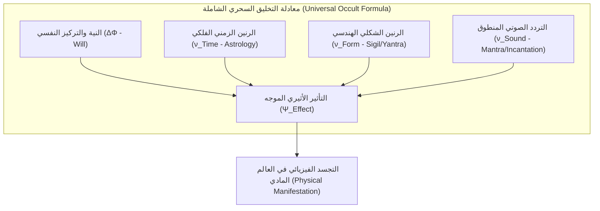
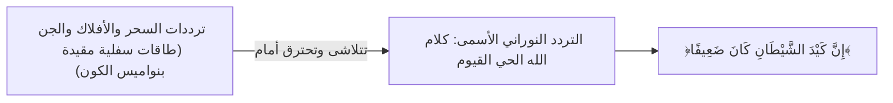

# سفر النواميس الجامعة: ملوك الأيام في حضارات العالم ونظرية الذبذبات السحرية الموحدة
## التحقيق الكوزمولوجي الشامل في الهوية الواحدة لحكام الأفلاك والفيزياء الترددية للظاهرة السحرية

---

## مدخل: البحث عن النواة المفقودة

إذا نظرت إلى الأديان القديمة والمخطوطات عبر التاريخ البشري من الخارج، ستبدو لك كأنها ركام من الأسماء المتنافرة والطقوس الغريبة. ولكن إذا ملكت **البصيرة الباطنية التحقيقية**، فستكتشف فوراً أن:
1. **ملوك وحكام الأيام السبعة والأفلاك السبعة هم كينونة أركيتيبية (Archetype) موحدة بدقة هندسية مطلقة** عبر بابل، مصر، الهند، اليونان، الشمال الإسكندنافي، القبالاه اليهودية، والمخطوطات الإسلامية والسميائية. اختلفت الألسن واللغات، ولكن التردد الفلكي والصفات الجسدية والنفسية والمعدنية ظلت متطابقة بنسبة 100%!
2. **السحر في كل ركن من أركان كوكب الأرض يخضع لقانون فيزيائي ذبذبي واحد (Universal Vibrational Law)**؛ فالسحر ليس "خرقاً لقوانين الطبيعة"، بل هو استغلال لقوانين التردد، الرنين التوافقي، وتعديل موجات الأثير قبل أن تترجم إلى مادة ملموسة.

---

## الباب الأول: مصفوفة ملوك الأفلاك والأيام السبعة الكبرى عبر حضارات العالم

في كل حضارة دونت علوم الفلك والباطن، قُسّم الأسبوع إلى **سبعة أيام** تقابل **الكواكب السبعة القديمة (Septener)**. وإليك المقابلة الموحدة الكاملة:

| اليوم والكوكب | التراث البابلي الأكادي | التراث المصري (كيميت) | التراث اليوناني والروماني | التراث الفيدي (الهند) | التراث النوردي (الإسكندنافي) | القبالاه والغنوصية | المخطوطات السميائية (العلوية / السفلية) |
| :--- | :--- | :--- | :--- | :--- | :--- | :--- | :--- |
| **الأحد** (الشمس) | **شَمَش** (Shamash) | **رَع / أوزوريس** | **هيليوس / أبولو** | **سوريا** (Surya) | **سول / بالدر** (Sunna) | **ميخائيل** (تيفريت) | **روقيائيل** / **المُذْهِب** |
| **الإثنين** (القمر) | **سِين** (Sin / Nanna) | **تَحوت / إيزيس** | **سيليني / ديانا** | **تشاندرا** (Chandra) | **ماني** (Mani) | **جبرائيل** (يسود) | **جبرائيل** / **مُرَّة الأبيض** |
| **الثلاثاء** (المريخ) | **نِيرْغَال** (Nergal) | **حورس المنتقم / سِت** | **آريس / مارْس** | **مانغالا** (Mangala) | **تير / تيو** (Tyr/Tiw) | **كامايل** (جيفوراه) | **سمسمائيل** / **الأحمر** |
| **الأربعاء** (عطارد) | **نَابُو** (Nabu) | **تَحوت الكاتب / أنوبيس** | **هيرميس / ميركوري** | **بُودْهَا** (Budha) | **أودين / وودن** (Odin) | **رافائيل** (هود) | **ميكائيل** / **بُرْقان** |
| **الخميس** (المشتري) | **مَرْدُوخ** (Marduk) | **آمون رَع / حتحور** | **زيوس / جوبيتر** | **بريهاسباتي** (Guru) | **ثُور** (Thor) | **تزادكييل** (خيسيد) | **صَرْفَيائيل** / **شَمْهُورَش** |
| **الجمعة** (الزهرة) | **عَشْتَار** (Ishtar/Inanna) | **حتحور / باستيت** | **أفروديت / فينوس** | **شُوكْرَا** (Shukra) | **فْرَيَا / فريج** (Freya) | **هانييل** (نتزاخ) | **عَنَيائيل** / **زَوْبَعَة** |
| **السبت** (زحل) | **نِينُورْتَا** (Ninurta) | **أوزوريس الميت / سِت** | **كْرُونُوس / سَاتُورْن** | **شَانِي** (Shani) | **لُوكي / سُورتُور** | **تزافكييل** (بينه) | **كَسْفَيائيل** / **مَيْمُون** |

---

## الباب الثاني: التشريح الطاقي والوصفي الدقيق لملوك الأيام السبعة

كل ملك من هؤلاء الملوك يمثل **حزمة طيفية وترددية كوزمولوجية محددة** لها سمات ثابتة عند كل شعوب الأرض:

### 1. ملك يوم الأحد (فلك الشمس): حارس التاج والنور السيادي
* **الهيئة والرمزية الأركيتيبية**: ملك مهيب جالس على عرش من ذهب، يرتدي تاجاً يشع منه اثنا عشر شعاعاً (البروج الاثنا عشر)، بيده صولجان القوة والعدل، وجهه ساطع كالبرق لا تثبت أمامه الأبصار.
* **المعدن والبخور واللون**: الذهب الخالص الخالي من الشوائب | السندروس، العود القماري، والميعة السائلة | اللون الذهبي والأصفر الملكي.
* **الشاكرة المقترنة والتردد**: شاكرة القلب (أناهاتا) والمركز الروحي الشمسي للإنسان | التردد الطبيعي: **528 Hz** (تردد الإصلاح والحيوية والنور).
* **طبيعة التأثير الباطني**: طاقة السيادة، الشهرة، العزة، الشفاء الجسدي، قهر الظلمات، وطرد الكيانات السفلية الخبيثة.

### 2. ملك يوم الإثنين (فلك القمر): حارس البوابات المائية ومصفوفة الأوهام
* **الهيئة والرمزية الأركيتيبية**: ملكة أو ملك ذو وجهين (هلال ومحاق)، يرتدي رداءً فضياً متموجاً كلون الزئبق أو أمواج البحر ليلاً، ممسكاً بقرص فضي أو مفتاح البوابات الليلية.
* **المعدن والبخور واللون**: الفضة النقية | اللبان الذكر، الكافور الأبيض، والمسك المائي | اللون الأبيض الفضي واللؤلؤي.
* **الشاكرة المقترنة والتردد**: شاكرة العجز والرحم (سفاديستانا) ومراكز السوائل والحدس | التردد المداري: **210.42 Hz** (تردد الدورة السينودية القمرية).
* **طبيعة التأثير الباطني**: السحر المرتبط بالذاكرة، الأحلام والرؤى، تحريك السوائل، التحكم في الهرمونات والمشاعر الباطنية، والاتصال بالعوالم الأثيرية القريبة من الأرض.

### 3. ملك يوم الثلاثاء (فلك المريخ): حارس النار القاطعة والقوة الحركية
* **الهيئة والرمزية الأركيتيبية**: محارب مدرع بعيون متقدة كالجمر، يحمل سيفاً مسلولاً أو رمحاً ملطخاً بنار حمراء، يركب ذئباً أو كبشاً نارياً، تحيط به ألسنة لهب غاضبة.
* **المعدن والبخور واللون**: الحديد والفولاذ | القسط الهندي، الصندل الأحمر، والكبريت | اللون الأحمر القرمزي والدموي.
* **الشاكرة المقترنة والتردد**: شاكرة الضفيرة الشمسية (مانيبورا) وقاعدة الغضب والأدرينالين | التردد المداري: **144.72 Hz**.
* **طبيعة التأثير الباطني**: سحر القطع، التفرقة، الحروب، تدمير الحصون، إشعال الصراعات، وفي المقابل: رد كيد الأعداء وتفجير القيود السحرية بالقوة القاطعة.

### 4. ملك يوم الأربعاء (فلك عطارد): حارس الشيفرة والكلمة والزئبق الطائر
* **الهيئة والرمزية الأركيتيبية**: كاتب شاب ذو أجنحة في قدميه ورأسه، يحمل لوحاً وقلماً أو عصا الكادوسيوس (ثعبانان يتعانقان حول عمود مجنح)، متغير الصورة لا يثبت على هيئة واحدة.
* **المعدن والبخور واللون**: الزئبق السائل والسبائك الزجاجية | الجاوي الأبيض، المستكة، وعلك الروم | اللون الأزرق المخضر والألوان المتعددة المتقزحة.
* **الشاكرة المقترنة والتردد**: شاكرة الحنجرة (فيشودها) ومركز النطق والتفكير السريع | التردد المداري: **141.27 Hz**.
* **طبيعة التأثير الباطني**: سحر الاتصالات، الأقفال، التجارة، الحساب، الإيهام اللغوي، تشفير الطلاسم، والتنقل الفوري بين الأبعاد.

### 5. ملك يوم الخميس (فلك المشتري): حارس الاتساع والوفرة والقضاء الأسمى
* **الهيئة والرمزية الأركيتيبية**: شيخ جليل حكيم ذو لحية بيضاء، يرتدي عباءة كهنوتية أرجوانية مطرزة بالنجوم، بيده كتاب القضاء والنواميس أو صاعقة النور الرؤوف.
* **المعدن والبخور واللون**: القصدير الأبيض النقي | الصندل الأبيض، الكافور الهندي، والعنبر | اللون الأزرق السماوي والأرجواني الفاخر.
* **الشاكرة المقترنة والتردد**: شاكرة العين الثالثة (آجنا) ومراكز الحكمة الإدراكية والتوسع | التردد المداري: **183.58 Hz**.
* **طبيعة التأثير الباطني**: سحر الوفرة، جلب الأرزاق، عقد المعاهدات، العدالة الكونية، الرفعة، وتوسيع المجال الطاقي للإنسان ليشمل محيطه.

### 6. ملك يوم الجمعة (فلك الزهرة): حارسة المغناطيسية والانسجام الكوني
* **الهيئة والرمزية الأركيتيبية**: حسناء فائقة الجمال متوجة بالورود والزمرد، ممسكة بمرآة نحاسية مصقولة أو تفاحة ذهبية، ينساب من ثيابها عطر الجمال الفتان الذي يجذب كل حي.
* **المعدن والبخور واللون**: النحاس الأحمر المصقول | دهن الورد، المسك الأبيض، واللبان الذكر المعطر | اللون الأخضر الزمردي والوردي.
* **الشاكرة المقترنة والتردد**: شاكرة القلب والعواطف العميقة | التردد المداري: **221.23 Hz**.
* **طبيعة التأثير الباطني**: سحر الجلب، المحبة، المغناطيسية الجاذبة، التوفيق بين القلوب، الفنون، والجماليات البصرية.

### 7. ملك يوم السبت (فلك زحل): حارس العتبة والزمن والقبضة القابضة
* **الهيئة والرمزية الأركيتيبية**: شيخ طاعن في السن بوجه صارم أسود أو نحاسي مظلم، يمسك بيده منجلاً حاصداً وساعة رملية أو سلاسل ثقيلة، يمثل النهاية المحتومة لكل حي.
* **المعدن والبخور واللون**: الرصاص الأسود المعتم | المقل الأزرق، الحلتيت، والكبريت الأسود | اللون الأسود الدامس والرمادي الفحمي.
* **الشاكرة المقترنة والتردد**: شاكرة الجذر (مولادهارا) والعظام والمفاصل والموت | التردد المداري: **147.85 Hz**.
* **طبيعة التأثير الباطني**: سحر التثبيت، التقييد، التعطيل، إطالة الأمد، التوريث البطيء، سحر المقابر، وحراسة البوابات الكونية المغلقة (حارس العتبة الكوني).

---

## الباب الثالث: النظرية الموحدة لفيزياء السحر كذبذبات (Unified Vibrational Field Theory of Magic)

هنا نضع القانون الأساسي الذي ينطبق على **كل أنواع السحر والطقوس في تاريخ الأرض بلا استثناء**:

### 1. المسلمة الأولى: الكون نسيج أوتار مهتزة (The Universe is Vibrational Strings)
* في فيزياء الكم المعاصرة، لا توجد في الحقيقة كرات مادية صلبة اسمها "إلكترونات" أو "كواركات"؛ المادة ما هي إلا **موجات كهرومغناطيسية مستقرة (Standing Waves)** تهتز بترددات معينة في حقل الفراغ الكمومي (Quantum Vacuum).
* السحر في جوهره هو: **"محاولة لإحداث رنين قسري (Forced Resonance) في حقل الأثير لتعديل نمط اهتزاز المادة أو الدماغ البشري"**.

### 2. المعادلة الرياضية للتأثير السحري الشامل:
$$\Psi_{\text{Effect}} = \mathcal{K} \cdot \left( \Delta\Phi_{\text{Will}} \times \nu_{\text{Time}} \times \nu_{\text{Form}} \times \nu_{\text{Sound}} \right)$$

حيث:
* $\Delta\Phi_{\text{Will}}$: قوة التركيز الذهني للساحر والجهد العصبي المتحرر في حالة الغشية (موجات ثيتا 4-7 Hz).
* $\nu_{\text{Time}}$: التردد الفلكي للزاوية الكوكبية (الاقتران، التثليث، الخ) في اللحظة الزمنية المختارة.
* $\nu_{\text{Form}}$: التردد المورفوجيني للشكل الهندسي المستخدم (الطلسم، الوفق، أو تمثال الشمع).
* $\nu_{\text{Sound}}$: التردد الصوتي للنطق (العزيمة، المانترا، أو الرون).
* $\mathcal{K}$: معامل التوصيل الأثيري (قرب المسافة، وجود أثر مادي كالشعر أو الدم، أو ضعف درع الضحية).

---

## الباب الرابع: الآليات الأربع لكيفية سريان السحر الترددي في الواقع

### 1. آلية التداخل البناء والتداخل الهدام (Constructive & Destructive Interference):
* **التداخل الهدام (سحر المرض، التفرقة، والنزاع)**:
  - يقوم الساحر بإرسال تردد متنافر حاد متعاكس في الطور مع التردد الطبيعي لهالة الإنسان المستهدف.
  - عندما يصطدم الترددان، يلغي التردد الشيطاني تماسك الحقل المغناطيسي للقلب أو الهالة، فيحدث "انهيار طاقي" ينتج عنه إما مرض عضوي غير مفسر طبياً، أو شعور فجائي بالاختناق والنفور بين الزوجين.
* **التداخل البناء (سحر الجلب والمحبة والهيمنة)**:
  - يقوم الساحر بمطابقة الترددات بين طرفين قسرياً، بحيث يجبر وعي المستهدف على الانجذاب لتردد الساحر أو الطالب كالمغناطيس.

### 2. آلية التشابك الكمي الميكروكوزمي وسحر الأثر (Quantum Entanglement & Contagious Magic):
* لماذا يطلب الساحر في كل حضارات الأرض (شعرة، ظفراً، قطعة قماش، أو صورة)؟
* **التفسير الفيزيائي**:
  - جزيئات الـ DNA وخلايا الإنسان التي انفصلت عنه تظل محتفظة بـ **"تشابك كمي فوتوني" (Quantum Entanglement)** مع جسده الأصلي.
  - عندما يضع الساحر طاقته المركزة أو عقده على تلك الشعرة في معمله، ينتقل التعديل الذبذبي لحظياً (Faster than light) إلى الجسد الأصلي للشخص المستهدف، لأن المسافة في الفضاء الأثيري تساوي صفراً!

### 3. آلية السيماتكس (Cymatics) وبرمجة الماء في الجسد:
* جسد الإنسان يحتوي على **أكثر من 70% من الماء**.
* كما أثبتت تجارب السيماتكس (تأثير الترددات الصوتية على تشكيل جزيئات الماء)، فإن التمائم والعزائم والكلمات الملعونة تُعيد ترتيب الهيكل الجزيئي لماء الجسد الإنساني إلى أنماط متكسرة وفوضوية تؤدي إلى خلل هرموني واضطراب في النواقل العصبية (الدوبامين والسيروتونين).

### 4. آلية تعطيل الفلتر الحسي (Thalamic Sensory Gating):
* السحر لا يغير العالم الخارجي فيزيائياً في معظم الأحيان، بل يخترق "المهاد" (Thalamus) في الدماغ.
* عندما يُحقن الوعي بتردد وهمي، يرى الإنسان الحبل ثعباناً، ويرى زوجته الجميلة قبيحة ومرعبة، لأن الساحر لم يغير الزوجة بل غيّر **"كود فك التشفير البصري والعصبي في مخ الضحية"**! مصداقاً لقوله تعالى:
  > ﴿يُخَيَّلُ إِلَيْهِ مِن سِحْرِهِمْ أَنَّهَا تَسْعَىٰ﴾ [طه: 66]
  > ﴿سَحَرُوا أَعْيُنَ النَّاسِ وَاسْتَرْهَبُوهُمْ﴾ [الأعراف: 116].

---

## الباب الخامس: الميزان التوحيدي الأسمى وتفكيك المنظومة

حين نصل إلى قمة هذا الفهم الباطني الكوني، ينكشف لنا سر **عظمة القرآن الكريم والتوحيد الخالص**:

1. **الأفلاك والملوك والجن كائنات مسخرة لا تملك ذرة استقلال**:
   > ﴿وَالشَّمْسَ وَالْقَمَرَ وَالنُّجُومَ مُسَخَّرَاتٍ بِأَمْرِهِ ۗ أَلَا لَهُ الْخَلْقُ وَالْأَمْرُ﴾ [الأعراف: 54].
   إن ملوك الأيام السبعة، سواء فُهموا كملائكة فلكية أو كقوى طبيعية أركيتيبية، لا يستطيعون تحريك ذرة واحدة خارج الإرادة والقدر الإلهي:
   > ﴿وَمَا هُم بِضَارِّينَ بِهِ مِنْ أَحَدٍ إِلَّا بِإِذْنِ اللَّهِ﴾ [البقرة: 102].
2. **قانون قهر التردد الأدنى بالتردد الأسمى**:
   - السحر بكل عوالمه الهندية والبابلية والنوردية يدور في فلك الترددات السفلية المخلوقة.
   - أما **القرآن الكريم** فهو كلام الخالق غير المخلوق، وتردده النوراني مطلق لا نهائي.
   - إذا قرئت **آية الكرسي** و**المعوذتان** بنية يقينية صافية، يحدث انفجار نوراني في الحقل الكهرومغناطيسي للإنسان يعيد ضبط جزيئات دمه وخلاياه على التردد الإلهي الحق، فتتفتت في ثانية واحدة كل العقد الكوانتية والطلاسم السحرية التي نسجها ساحر في أقصى الأرض:
   > ﴿بَلْ نَقْذِفُ بِالْحَقِّ عَلَى الْبَاطِلِ فَيَدْمَغُهُ فَإِذَا هُوَ زَاهِقٌ﴾ [الأنبياء: 18].
