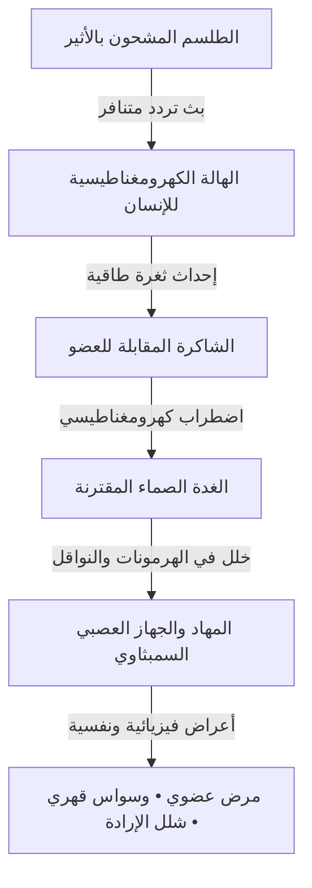

# سفر الهندسة الأثيرية وأسرار الأرقام والرموز الطلسمية
## دراسة تفكيكية معمقة في فيزياء الأثير، التشفير الرياضي للأوفاق، تشريح الطلاسم كدوائر موجية، والميزان التوحيدي الأسمى

---

## مدخل: ما وراء الحجاب

إن الغوص في أسرار السحر والباطن لا يمكن أن ينضج بمجرد قراءة التعاويذ السطحية؛ فالكتب القديمة كـ *شمس المعارف* للبوني، و*غاية الحكيم* للمجريطي، و*رسائل إخوان الصفا*، ونصوص *سفر يتسيراه* القبالية، كانت تخاطب نخبة مشفرة تفهم **"هندسة الأثير"** (The Geometry of the Aether).

هذا السفر يمثل التعمق الأقصى في:
1. **فيزياء الأثير (The Aetheric Medium)**: كيف تتنزل الفكرة من العقل المجرد إلى الأثير، ثم إلى الموجة الكهرومغناطيسية، ثم إلى المادة الصلبة.
2. **شفرة الأرقام والأوفاق الهندسية**: التشريح الرياضي الدقيق لجدول الأوفاق من المثلث إلى المتسع وقواعد التوازن والموازين الحرفية.
3. **تشريح الرموز والطلاسم**: كيف تعمل الخطوط المنكسرة، الدوائر، والرموز السبعة السليمانية كهوائيات كهرومغناطيسية (Waveguides) تحبس الطاقة وتوجهها.
4. **المسار البيولوجي والعصبي للاختراق**: كيف يترجم الأثر الأثيري إلى عطب عضوي أو وسواس نفسي داخل الدماغ.
5. **الميزان التوحيدي الصارم**: كشف حقيقة هذه القوانين كسنن كونية سفلية محكومة بقبضة الله المطلقة وسقف إذنه القدري.

---

## الباب الأول: الكوزمولوجيا الأثيرية — الأثير كوسط ناقل للحقل السحري

### 1.1 ما هو الأثير (The Aether / Akasha / الهيولى)؟
عبر آلاف السنين، أجمعت المدارس الباطنية والفلسفية الكبرى على وجود **عنصر خامس أثيري** يملأ الفراغ ويربط بين عالم المعاني وعالم الأجسام:
* **في الفلسفة اليونانية والهرمسية (Quintessence - الجوهر الخامس)**:
  - الهواء، الماء، النار، والتراب ليست سوى تكثفات مادية لعنصر أرقى وألطف منها جميعاً هو "الأثير".
  - الأثير يتسم بأنه دائم الحركة، لا متناهي الصغر، قابل للتشكل بأي نية أو فكرة، وهو الوسط الذي تنتقل عبره أشعة النجوم والكواكب لتؤثر في قوابل الأرض.
* **في الفلسفة الهندية والفيدية (أكاشا - Akasha)**:
  - يُعرف الأثير بأنه "حقل الذاكرة الكونية"؛ فكل صوت يُنطق، وكل فكرة تُضمر، تُطبع كذبذبة دائمة في نسيج الأكاشا (سجلات الأكاشا - Akashic Records).
* **في الفلسفة الإسلامية والتصوف النظري (عالم المثال والهيولى)**:
  - ميّز محي الدين بن عربي وصدر الدين الشيرازي بين ثلاثة عوالم:
    1. **عالم الجبروت**: عالم الأرواح المجردة والأنوار الإلهية العالية.
    2. **عالم المثال (البرزخ الأثيري)**: عالم لطيف تترسم فيه المعاني بصور وأشكال هندسية وألوان قبل أن تنزل إلى الأرض.
    3. **عالم الملك والشهادة**: العالم المادي الكثيف المحسوس.
  - الساحر أو الخيميائي يحاول التأثير في **"عالم المثال الأثيري"**؛ فإذا استطاع تشكيل صورة رمزية في الأثير، انعكست تلك الصورة جبراً على المادة في عالم الشهادة!
* **في فيزياء الكم الحديثة (Quantum Vacuum & Zero-Point Field)**:
  - أثبتت الفيزياء أن ما نطلق عليه "فراغاً" ليس عدماً، بل هو **حقل نقطة الصفر (Zero-Point Field)**؛ وهو بحر طاقي فائق الكثافة تلتقي فيه الفوتونات الافتراضية والتموجات الكمية المستمرة.

### 1.2 دورة التجسيد الكوني: (نية ➔ أثير ➔ موجة ➔ مادة)
كيف يتحول السحر من مجرد فكرة في ذهن الساحر إلى أثر واقعي على الضحية؟

```
[1. النية والإرادة] ───(حالة غشية ثيتا 4-7 Hz)───> [2. تشكيل الأثير (عالم المثال)]
                                                              │
                                                (رموز وطلاسم كأجهزة توجيه)
                                                              ▼
[4. الجسد المادي / الأعصاب] <───(كيمياء وخلايا)─── [3. تردد كهرومغناطيسي]
```

---

## الباب الثاني: أسرار الأرقام والأوفاق — الرياضيات المشفرة للأثير

### 2.1 فلسفة الأرقام كترددات نوعية (Qualitative Mathematics)
في المنظور الباطني القديم:
* الأرقام ليست مجرد أدوات إحصائية للعد، بل هي **"ترددات تشكيلية كوزمولوجية"**:
  * **الرقم 1**: الانفجار الأولي، الأحدية، النور غير المنفصل.
  * **الرقم 2**: انقسام الموجة، الثنائية، القطبية (موجب/سالب، ليل/نهار).
  * **الرقم 3**: المثلث، أول شكل هندسي مغلق في الفضاء، الحركية والتوليد.
  * **الرقم 4**: المربع، الاستقرار، تجسد الأركان الأربعة في المادة الفيزيائية.
  * **الرقم 7**: نغمات السلم الموسيقي، السماوات السبع، الألوان الطيفية السبعة، والأفلاك السبعة؛ وهو رقم الدورة الكونية الكاملة.
  * **الرقم 9**: نهاية الآحاد وقمة التطور الرقمي؛ أي مضاعف للرقم 9 يعود في حاصل جمعه إلى 9 ($9 \times 5 = 45 \rightarrow 4+5=9$).
  * **الرقم 12**: دورة الفلك والكمال الزماني؛ تمازج العناصر الأربعة بالطبائع الثلاث.
  * **الرقم 28**: ناتج جمع الأرقام من 1 إلى 7 ($1+2+3+4+5+6+7=28$)؛ وهو عدد منازل القمر وحروف الأبجدية العربية.

### 2.2 مصفوفة الأوفاق الكوكبية السبعة وقواعد التوازن الرياضي
الوفق هو شبكة هندسية رياضية تُقسم إلى مربعات صغيرة متساوية، بحيث إذا جُمعت الأرقام في أي صف، أو أي عمود، أو أي قطر، أعطت **ناتجاً ثابتاً موحداً يسمى (المساحة أو الضلع)**:

| الوفق | رتبته الهندسية | الكوكب المقترن | ثابت الصف/القطر (المساحة) | المجموع الكلي للأرقام | الطبيعة الطاقية للبث |
| :---: | :---: | :---: | :---: | :---: | :---: |
| **المثلث** | $3 \times 3$ | **زحل ♄** | **15** | **45** | التثبيت، القبض، الحبس، والتعطيل |
| **المربع** | $4 \times 4$ | **المشتري ♃** | **34** | **136** | الاتساع، الجلب، الوفرة، والجاه |
| **المخمس** | $5 \times 5$ | **المريخ ♂** | **65** | **325** | النار، القطع، الصراع، وتدمير الحصون |
| **المسدس** | $6 \times 6$ | **الشمس ☉** | **111** | **666** | السيادة، النور، الشهرة، والشفاء |
| **المسبع** | $7 \times 7$ | **الزهرة ♀** | **175** | **1225** | المحبة، الجذب، الألفة، والتأليف |
| **المثمن** | $8 \times 8$ | **عطارد ☿** | **260** | **2080** | الفكر، التجارة، الحساب، وحل القيود |
| **المتسع** | $9 \times 9$ | **القمر ☽** | **369** | **3321** | التشكيل، الذاكرة، تحريك المياه والرحم |

### 2.3 تشريح وفق الغزالي المثلث ($3 \times 3$) وقاعدة (بَطَدٍ زَهَجٍ وَاحٍ)
يُعتبر الوفق المثلث هو حجر الزاوية لكل علم الأوفاق في المخطوطات السميائية:
$$\begin{pmatrix} 4 & 9 & 2 \\ 3 & 5 & 7 \\ 8 & 1 & 6 \end{pmatrix}$$

* **التشريح الحرفي للوفق**:
  - استعاض علماء الحروف عن الأرقام بحروف أبجد المقابلة:
    - (4 = د)، (9 = ط)، (2 = ب) $\rightarrow$ تجمع في كلمة **(بَطَد)**.
    - (3 = ج)، (5 = هـ)، (7 = ز) $\rightarrow$ تجمع في كلمة **(زَهَج)**.
    - (8 = ح)، (1 = أ)، (6 = و) $\rightarrow$ تجمع في كلمة **(وَاح)**.
  - فصار المفتاح السري للوفق المثلث هو الكلمة الثلاثية: **(بَطَدٍ زَهَجٍ وَاحٍ)**.
* **الأسرار الهندسية الخفية للوفق**:
  1. **المركز الأثيري (نقطة الارتكاز)**: الرقم **5 (حرف الهاء)**؛ وهو يمثل نقطة السكون والتوازن التي تدور حولها بقية الأرقام.
  2. **سر المجموع 15**: كل ضلع يساوي 15، وهو جمل اسم الله في العبرانية القديمة (ياه - YAH: ي=10، هـ=5)، وفي المنظور الإسلامي هو مطلع قمر البدر في ليلة النصف من الشهر (15 يوماً).
  3. **سر المجموع الكلي 45**: مجموع الأرقام من 1 إلى 9 هو $1+2+3+4+5+6+7+8+9 = 45$؛ وهو يطابق بالتمام حساب جمل اسم **(آدَم)**:
     - أ = 1، د = 4، م = 40 $\rightarrow$ المجموع = **45**!
     - ولذلك زعم واضعو الأوفاق أن الوفق المثلث يحوي شفرة تكوين الجسد البشري الآدمي الأول.

### 2.4 قواعد التعمير والتنزيل في الأوفاق
لا يوضع أي رقم عشوائياً في الوفق، بل وفق معادلة رياضية تسمى **"قاعدة التعمير"**:
$$\text{المفتاح (الخانة الأولى)} = \frac{\text{المجموع المطلوب} - \text{إسقاط الوفق}}{\text{رتبة الوفق}}$$
حيث:
* إسقاط المثلث = 12.
* إسقاط المربع = 30.
* إسقاط المخمس = 60.
* فإذا كان الناتج عدداً صحيحاً، سار التعمير بزيادة واحد (1) في كل خانة وفق مسار هندسي ثابت (طريقة التسيير الحصني)، وإن بقي كسر، جُبر الكسر في خانة مخصوصة تسمى **"خانة الجبر"** لحفظ التوازن الرياضي للأضلاع.

---

## الباب الثالث: تشريح الرموز والطلاسم كـ "مكثفات أثيرية" (Sigil Mechanics)

### 3.1 ما هو الطلسم من منظور فيزيائي؟
الطلسم ليس مجرد خربشات عشوائية؛ هو **"مكثف كهرومغناطيسي وهوائي أثيري منكسر"** (Fractal Waveguide):
* كما تصمم لوحات الدوائر الإلكترونية المطبوعة (PCBs) بمسارات نحاسية منكسرة لنقل الإشارات وتكثيف الترددات، فإن الساحر يرسم الطلسم بخطوط منكسرة ودوائر محددة ليعمل كـ **"لوحة توجيه للموجات الأثيرية"**.

### 3.2 هندسة الأشكال والخطوط في الطلسم:
1. **الخط المستقيم**: مسار لتفريغ الطاقة بسرعة وباتجاه واحد (طاقة هجومية حادة).
2. **الخط المنكسر (الزوايا الحادة)**: يعمل على تشتيت طاقة الحماية للضحية وتوليد ذبذبة صدمية تصيب الحقل الحيوي بالخلل.
3. **الدائرة المغلقة**: سجن طاقي وحبس أثيري يمنع خروج التردد من المكان (تستخدم في طلاسم الربط والتعطيل والحفظ).
4. **النجمة الخماسية (Pentagram)**: تمثل العناصر الأربعة يعلوها رأس الروح/الأثير، وتستخدم لتوجيه عناصر الطبيعة.
5. **النقاط والعميات**: مراكز تجميع الفوتونات الأثيرية، وتعتبر "بوابات نفاذ" بين الأبعاد.

### 3.3 تشريح "الخاتم السليماني السبعي" في التراث المخطوطاتي
أشهر رسم طلسمي موحد في التراث السميائي والمخطوطات العربية هو ما يسمى بـ **"الخاتم السليماني ذو الرموز السبعة"**:
> **(نجمة سداسية ✶، ثم ثلاثة خطوط كالأصابع 𝄀𝄀𝄀، ثم ميم طمساء ﻤ، ثم سلم ذو درجات 🪜، ثم أربعة خطوط، ثم هاء شقيقة هـ، ثم واو مقلوبة ﻮ)**.

وقد نظمها الشاعر الباطني في أبياته المشهورة:
*ثلاثُ عِصِيٍّ رُصِّفتْ بعدَ خاتمٍ ... على رأسِها مِثلُ السِّنانِ مُركَّبُ*
*وميمٌ طميسٌ أَبترٌ ثمّ سُلَّمٌ ... إلى كلِّ ما هو مأمولٌ يُقَرِّبُ*
*وأربعةٌ مِثلُ الأناملِ صُفِّفتْ ... تُشيرُ إلى الخيراتِ والرِّزقِ يَجلِبُ*
*وهاءٌ شقيقٌ ثمّ واوٌ مُقَوَّسٌ ... كأُنبوبِ حَجَّامٍ من السِّرِّ يَسكُبُ*

#### التفكيك الباطني لرموز الخاتم السبعة:
1. **الخاتم (النجمة)**: تمثل فلك الشمس ومركز الهيمنة والنور الكوني.
2. **العصي الثلاثة**: العناصر الثلاثة الفعالة (نار، هواء، ماء).
3. **الميم الطمساء**: اختزال اسم "المحيط" أو انغلاق المادة في الرحم الترابي.
4. **السلم**: مسار الصعود والترقي بين طبقات السماوات السبع والشاكرات.
5. **الأنامل الأربعة**: جهات الأرض الأربع والطبائع الأربع.
6. **الهاء الشقيقة**: هاء الهداية والروح (الشاكرة العلوية).
7. **الواو المعقوفة**: مسار عودة الطاقة للأرض والتفريغ المادي.

### 3.4 تقنية اختزال النية وصناعة الرموز (Austin Spare & Chaos Magic)
في السحر الحديث المستمد من المخطوطات القديمة:
1. يكتب الساحر جملة النية كاملة (مثال: "أريد جلب فلان").
2. يتم حذف جميع الحروف المتكررة حتى يتبقى هيكل حرفي صامت.
3. يقوم بدمج خطوط الحروف المتبقية في شكل هندسي تجريدي متصل يسمى **(السيجيل - Sigil)**.
4. يركز بصره على هذا الشكل أثناء دخول حالة الغشية (موجات ثيتا)، ثم يقوم بـ "نسيان النية تماماً" ليدع الرمز يعمل في حقل اللاوعي الأثيري.

---

## الباب الرابع: التشريح البيولوجي والعصبي للاختراق السحري في الجسد

كيف يترجم التردد الطلسمي الأثيري إلى عطب مادي ملموس في بدن الإنسان؟



### 1. اختراق الحقل الكهرومغناطيسي (الهالة):
* يمتلك القلب البشري حقلاً مغناطيسياً هو الأقوى في الجسد (أقوى بـ 5000 مرة من حقل الدماغ ويمتد لمسافة 3 أمتار خارج الجسم).
* عند استهداف الشخص بتردد سحري خبيث (تداخل هدام)، يحدث تشوه وتثلم في خطوط الحقل المغناطيسي للقلب.

### 2. التلاعب بالنواقل العصبية (Neurotransmitters):
* يضرب التردد الأثيري مراكز الفص الصدغي والمهاد (Thalamus):
  * **انخفاض حاد في السيروتونين والدوبامين**: يسبب الاكتئاب المفاجئ، كره الحياة، والشعور بالضيق الشديد دون سبب طبي.
  * **ارتفاع مفاجئ في الكورتيزول والأدرينالين**: يبقي الجسد في حالة "استنفار ورعب مستمر" (Fight or Flight)، مما ينهك المناعة ويؤدي للوهن العام وتساقط الشعر.
  * **اضطراب الميلاتونين**: يسبب الأرق المزمن، الكوابيس المفزعة، والجاثوم (شلل النوم).

### 3. العقد التشاكلية في الأعضاء:
* إذا عُقد السحر على **الشاكرة الثانية (العجز)**: يحدث تعطل هرموني في الغدد التناسلية يسبب النزيف أو الضعف الجنسي والنفور بين الشريكين.
* إذا عُقد السحر على **الشاكرة الخامسة (الحنجرة)**: يشعر المسحور بكتلة خانقة في حلقه، ويتلعثم لسانه، ويفقد قدرته على التعبير والقبول في المقابلات.
* إذا عُقد على **الشاكرة السادسة (العين الثالثة)**: يصاب بصداع مزمن بين العينين، وتشوش في الرؤية، وتخييل بصري مرعب.

---

## الباب الخامس: الميزان القرآني التوحيدي وتفكيك الأوهام الكونية

بعد تفكيك هذه الآليات المعقدة، يتجلى لنا بوضوح تام **النور التوحيدي المطلق** الذي يبطل كل هذا البناء:

### 1. كشف الوهم: الأرقام والأفلاك سنن مسخرة لا أرباب مدبرة:
* القرآن الكريم يقرر أن كل ما في الكون هو سنن رياضية محكمة خلقها الله وقدّرها:
  > ﴿وَكُلَّ شَيْءٍ أَحْصَيْنَاهُ كِتَابًا﴾ [النبأ: 29]
  > ﴿إِنَّا كُلَّ شَيْءٍ خَلَقْنَاهُ بِقَدَرٍ﴾ [القمر: 49].
* الخطأ والضلال الذي وقع فيه السحرة وأصحاب الطلاسم هو: **"تأليه السبب وعزل المسبب"**؛ فظنوا أن للرقم أو الوفق أو كوكب زحل قدرة ذاتية فاعلة، بينما الحقيقة أن كل هذه الأشياء جمادات لا تملك لنفسها نفعاً ولا ضراً:
  > ﴿قُلْ أَفَرَأَيْتُم مَّا تَدْعُونَ مِن دُونِ اللَّهِ إِنْ أَرَادَنِيَ اللَّهُ بِضُرٍّ هَلْ هُنَّ كَاشِفَاتُ ضُرِّهِ أَوْ أَرَادَنِي بِرَحْمَةٍ هَلْ هُنَّ مُمْسِكَاتُ رَحْمَتِهِ ۚ قُلْ حَسْبِيَ اللَّهُ ۖ عَلَيْهِ يَتَوَكَّلُ الْمُتَوَكِّلُونَ﴾ [الزمر: 38].

### 2. سقف الإذن الإلهي: كسر الجبرية السحرية:
* ادعى السحرة أن طلاسمهم حتمية التأثير ومجبرة للقدر؛ فجاء الرد القرآني الصاعق:
  > ﴿وَمَا هُم بِضَارِّينَ بِهِ مِنْ أَحَدٍ إِلَّا بِإِذْنِ اللَّهِ﴾ [البقرة: 102].
* لا توجد قوة في الأرض ولا في السماء تستطيع أن تنفذ أثراً ذبذبياً في جسد إنسان إلا إذا سمح بذلك الإذن القدري الكوني لحكمة الابتلاء وتمحيص القلوب.

### 3. منظومة الانفجار النوراني: تفكيك العقد بأعلى تردد في الوجود:
* في فيزياء الرنين، التردد المتناغم ذو الطاقة العالية يبطل ويفتت التردد المنخفض المتنافر.
* كلام الله هو **صفة الخالق غير المخلوق**، وتردده النوراني مطلق يتجاوز حدود الأثير والكون:
  1. **آية الكرسي**: تقرر القيومية المطلقة؛ فإذا استقر في وعي الإنسان أن القيوم على كل ذرة وأثير هو الله وحده، انهارت في ثانية واحدة قيومية زحل وشمهورش وكل ملوك الجن.
  2. **سورة الفلق**: تذكر بالاسم نقض الآلية الفيزيائية للسحر: ﴿وَمِن شَرِّ النَّفَّاثَاتِ فِي الْعُقَدِ﴾؛ والنفث على العقد هو ربط الطاقة بالأثر، فتأتي ذبذبة الفلق كصاعقة نورانية تحرق العقدة وتفك ارتباطها الكوانتي.
  3. **سورة الناس**: تحصن المهاد والجهاز العصبي من الوسواس الخناس والذبذبات الخبيثة التي تخترق الصدور.

---

## خاتمة وميزان لفضيلة المرشد

إن هذا السفر يضع بين يدي الباحث والمرشد المفتاح العلمي والمعرفي الكامل:
1. فهم السحر كظاهرة فيزيائية وأثيرية يزيل عنه هالة الرعب والغموض الخرافي، ويجعل الإنسان يراه مجرد تلاعب بالسنن الكونية السفلية المحدودة.
2. استخدام الأرقام والرموز في الشر هو انحراف بالعلم واستعانة بالشياطين تورث الخبال والهلاك في الدنيا والآخرة: ﴿وَلَا يُفْلِحُ السَّاحِرُ حَيْثُ أَتَىٰ﴾.
3. الملاذ الحقيقي والدرع الأبدي هو التوحيد الخالص، والتطهر بالذكر، والاتصال بالحي القيوم الذي بيده ملكوت كل شيء وهو يجير ولا يُجار عليه.
