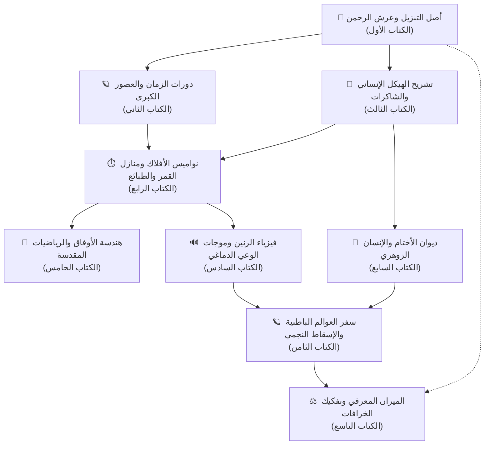

# 🏛️ دليل المنهج التعليمي الكلي: هيكلة المكتبة الباطنية والنواميس الكونية

> **«يُؤْتِي الْحِكْمَةَ مَن يَشَاءُ ۚ وَمَن يُؤْتَ الْحِكْمَةَ فَقَدْ أُوتِيَ خَيْرًا كَثِيرًا ۗ وَمَا يَذَّكَّرُ إِلَّا أُولُو الْأَلْبَابِ»** [البقرة: 269]

---

## 📌 فلسفة الهيكلة وتفكيك التكرارات

لقد نشأ هذا الصرح المعرفي ليكون **موسوعة ومكتبة تعليمية باطنية حكيمة ومحكمة**، تعالج التشتت، وتزيل التكرارات العشوائية، وتربط كل فرع معرفي بأصله الكوزمولوجي، الفيزيائي، والروحي.

تنتظم المكتبة في **تسعة كتب ومناهج تعليمية عظمى**، تتكامل فيما بينها وفق مصفوفة معرفية دقيقة، تنطلق من *الوحي والتنزيل الكلي*، مروراً بـ *قوانين الطبيعة والأفلاك والرياضيات والأثير*، وصولاً إلى *مراقي الوعي والميزان النقدي الصارم*.

---

## 📚 مسرد المناهج التعليمية التسعة والروابط البينية

| رقم السفر | عنوان الكتاب والمنهج التعليمي | المحور والغاية المعرفية | الأبواب المناظرة في البوابة التفاعلية |
| :--- | :--- | :--- | :--- |
| **الكتاب 01** | `Book_01_Quranic_Cosmology_and_Prophetic_Spheres` | كوزمولوجيا التنزيل، السماوات السبع، عرش الرحمن، ومقامات الأنبياء. | الأبواب 01، 02، 06 |
| **الكتاب 02** | `Book_02_Astrological_Ages_Precession_and_Civilization_Cycles` | المبادرة المحورية (2,160 سنة)، تعاقب العصور والشرائع، وتاريخ الحضارات. | الأبواب 04، 05 |
| **الكتاب 03** | `Book_03_Human_Energetic_Anatomy_Chakras_and_Subtle_Bodies` | تشريح الهيكل الطاقي، الشاكرات السبع، الأجساد السبعة، وميكانيكا الهالة. | الأبواب 03، 14 |
| **الكتاب 04** | `Book_04_Celestial_Kings_Lunar_Mansions_and_Chaldean_Hours` | ملوك الأفلاك والأيام، ملائكة الوجوه الـ 36، الساعات الكلدانية، ومنازل القمر. | الأبواب 09، 10، 11، 12، 13 |
| **الكتاب 05** | `Book_05_Sacred_Mathematics_Magic_Squares_and_Algebraic_Wafqs` | الهندسة الجبرية للأوفاق، الموجات الأثيرية الواقفة، وتفكيك أوفاق الغزالي ولو شو. | الأبواب 15، 20 (القسم 4) |
| **الكتاب 06** | `Book_06_Cosmic_Resonance_Cymatics_and_Brainwave_Frequencies` | فيزياء الرنين المداري، ترددات الكواكب (528Hz)، ومختبر موجات الدماغ (Theta/Gamma). | الأبواب 16، 20 (القسم 5) |
| **الكتاب 07** | `Book_07_Solomon_Sigils_Zouhri_Anatomy_and_Soul_Lineages` | الهندسة الرمزية لخاتم سليمان، التشريح الطبي والأنثروبولوجي للزوهريين، والسلالات. | الباب 19 |
| **الكتاب 08** | `Book_08_Inner_Realms_Astral_Projection_and_Etheric_Cleansing` | أساطير الأرض المجوفة (أغارثا)، الإسقاط النجمي بمراحله، وتنظيف القرين والهالة. | الأبواب 18، 20 (الأقسام 1، 2، 3) |
| **الكتاب 09** | `Book_09_The_Epistemic_Criterion_Manuscript_Critique_and_Demystification` | الميزان النقدي الصارم، حماية الوعي من الشعوذة، ونقد تحريفات المخطوطات. | الأبواب 07، 08، 17 |

---

## 🧭 مصفوفة تفكيك التكرارات المنهجية (Deduplication Rules)

1. **توحيد المراجع الفلكية**:
   - لا يتم تكرار تعريف الأفلاك في كل فصل؛ فـ **فلك القمر لآدم** و **فلك زحل لإبراهيم** أصله في `الكتاب 01`، وتطبيقه العملي في الساعات والمنازل في `الكتاب 04`، وحسابه الرياضي في المرصد في الباب 18.
2. **توحيد مبحث الأوفاق والمربعات**:
   - الأوفاق تُعالج رياضياً وفيزيائياً بصفتها **مصفوفات جبرية وموجات أثيرية واقفة** حصراً في `الكتاب 05`، وتُنزّه الحقيقة النبوية من التمائم السحرية في `الكتاب 09`، مما يمنع التكرار والخلط بين العلم الرياضي والتنجيم الشعبي.
3. **توحيد مبحث الهيكل الإنساني والوعي**:
   - التشريح الحيوي الغددي للشاكرات يقع في `الكتاب 03`، بينما تقنيات الخروج الأثيري (الإسقاط النجمي) وتنقية القرين تقع في `الكتاب 08`، مع ربط دائم بالترددات الفيزيائية في `الكتاب 06`.
